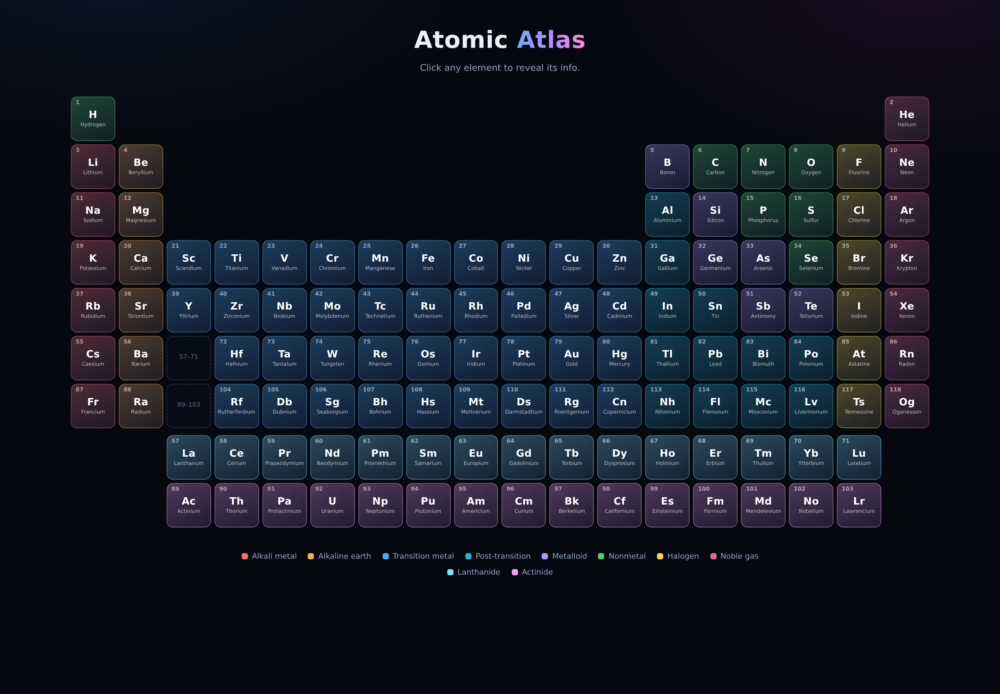
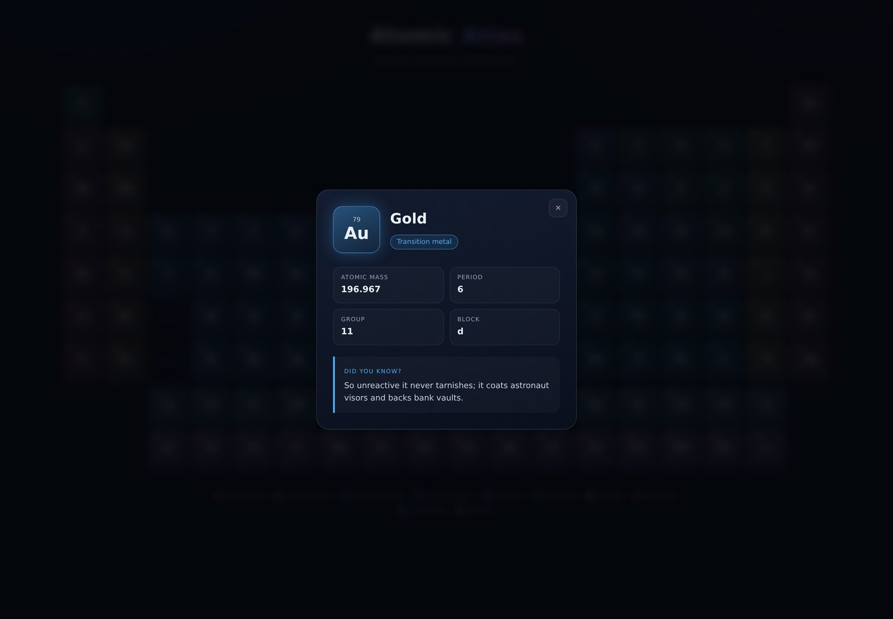
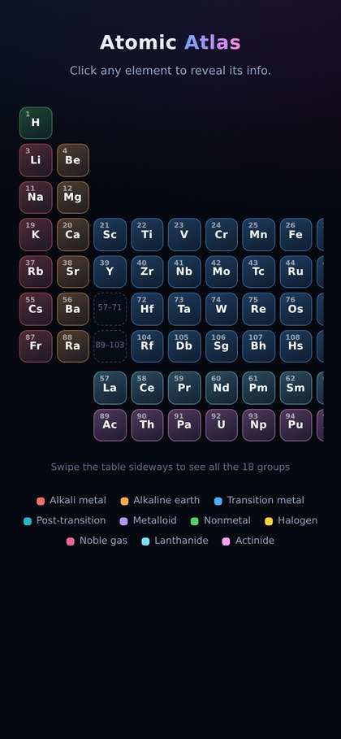

# Atomic Atlas

This is a modern and interactive periodic table. It is made using only plain HTML, CSS, and JavaScript. No extra frameworks or libraries are used. The design is clean, simple, and easy to use on any device. You can click on any element in the table to learn more about it. When you click, it will show you all the basic details of that element. You can see its name, symbol, atomic number, and mass number. It will also show you which period it belongs to, which group it belongs to, and which block it comes from. Along with the basic information, it also shows you one interesting and fun fact about that element. This makes learning chemistry more fun and easy to remember. This project is perfect for students who want to learn the periodic table in a simple and interactive way, instead of just reading from a book.




## Try it here

https://atomic-atlas-two.vercel.app/

## Features

- All 118 elements in the correct 18-column layout
- Click an element to open a card with its number, symbol, name, mass, period, group, block and a fact
- Elements are colour coded by category, with a legend at the bottom
- Data lives in a separate `elements.json` file, so it is easy to edit or add to
- Works on phones too, where the table scrolls sideways
- No frameworks and no libraries, just HTML, CSS and JavaScript

## Running locally

```bash
git clone https://github.com/Yuser00123/Atomic-Atlas
cd Atomic-Atlas
python3 -m http.server
```

Then open http://localhost:8000 in your browser.

You need a small local server because the page loads `elements.json` with `fetch()`, and browsers block that when you open the file directly.

## Built with

- HTML
- CSS (CSS Grid and flexbox, no frameworks)
- JavaScript (no libraries)
- `elements.json` for the element data

## Screenshots

| Element card | On mobile |
| --- | --- |
|  |  |
